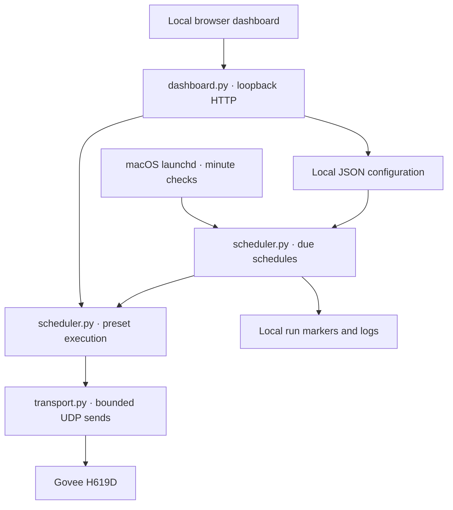

# Automated Room Project

A Python lighting controller that runs Govee H619D presets and daily schedules over the local network. Built by Zachary Johnson as a personal engineering project using a Mac mini and existing room hardware.

The working prototype includes a browser dashboard, configurable RGB and brightness presets, a one-shot scheduler, input validation, bounded UDP retries, and automated tests. Python's standard library is the only dependency.

## What works, and what has been verified

| Capability | Implementation and evidence |
| --- | --- |
| Lighting control | Power, RGB and brightness commands over LAN UDP; manual hardware results recorded October 10, 2026 |
| Unattended scheduling | Two user-observed tests on October 10: a calendar trigger at 22:30 and a config-driven Morning → Focus change at 22:39 |
| Local dashboard | Preset buttons, power, brightness, color, and schedule editing; HTTP behavior covered by automated tests; physical dashboard checks remain to be recorded |
| Configuration safeguards | Validated presets/schedules, stale-edit detection, backup and atomic configuration replacement |
| Failure handling | Socket timeout, three send attempts, bounded backoff, logging, and failed schedules left eligible for retry in the same minute |
| Automated verification | Mocked transport and temporary files; no physical lights required |

This is a **single-device lighting prototype**. TV/audio integration, seasonal coordination, pause/resume, and the original 30-run acceptance target remain future work. The broader [initial charter](docs/project-charter.md) is a planning baseline, not a completion claim.

## Architecture



The dashboard edits schedules but does not run them. macOS `launchd` must invoke `scheduler.py check` every minute. No cloud service, API key, or purchased hub is used by this implementation.

## Quick start

Python 3.9+ is required. The deployed scheduling approach uses macOS. Tests can run without a Govee device.

```sh
git clone https://github.com/johnsonzach0811/Automated-Room-Environment.git
cd Automated-Room-Environment
cp config.json config.local.json
python3 -B -m unittest discover -s tests -v
```

`config.json` is a portable example: its address is a documentation placeholder and every schedule is disabled. Set `device.ip` in the ignored `config.local.json` to the light's actual LAN address. Enable LAN Control in Govee Home for the supported device and place the controller on the same reachable network.

```sh
python3 -B scheduler.py validate
python3 -B dashboard.py
```

Open [http://127.0.0.1:8765](http://127.0.0.1:8765). Manual control buttons send real lighting commands. To test a preset directly:

```sh
python3 -B scheduler.py preset morning
python3 -B scheduler.py preset focus
python3 -B scheduler.py preset night
```

All entry points prefer `config.local.json` when present, otherwise `config.json`. Use `--config /absolute/path/to/config.json` to select another file. The legacy `lights.py on|off` also uses this configuration.

**Existing Mac installation:** before pulling this cleanup, copy your current working `config.json` to `config.local.json` so your device address and enabled schedules are retained. This checkout's example configuration does not enable unattended actions.

See [dashboard and setup details](docs/local-dashboard.md) and [scheduler setup](docs/configurable-automation.md). No LaunchAgent files are installed by these commands.

## Engineering decisions and limitations

- **Configuration over duplicated scripts:** presets and schedules share one validated JSON configuration.
- **Local control:** loopback HTTP with a session token, Host/Origin checks, and bounded JSON requests. This is a local utility, not a public web service.
- **Honest status reporting:** UDP send success means the OS accepted a datagram. It does not confirm the light applied it; an offline device can appear to send successfully.
- **Predictable scheduling:** checks match the current local minute and weekday. Run markers prevent sequential repeat checks in that minute. There is no missed-event catch-up or overlapping-process lock; use one scheduler job.
- **Availability constraint:** the Mac must be awake and reachable. Restart, logout, DHCP changes, and long-term unattended reliability need additional physical testing.
- **Manual control:** changes do not pause schedules. A later scheduled preset can overwrite them.

## Evidence and project records

- [First unattended hardware test](docs/automation-test-success-2026-10-10.md)
- [Config-driven unattended test](docs/configurable-scheduler-test-2026-10-10.md)
- [Transport and scheduler reliability](RELIABILITY.md)
- [Initial charter](docs/project-charter.md), [scope](docs/scope-statement.md), and [compatibility register](templates/compatibility-register.csv)

Dated planning/progress files describe the project at that date and may list features that have since been implemented. Current behavior is summarized above. No open-source license has been selected.
