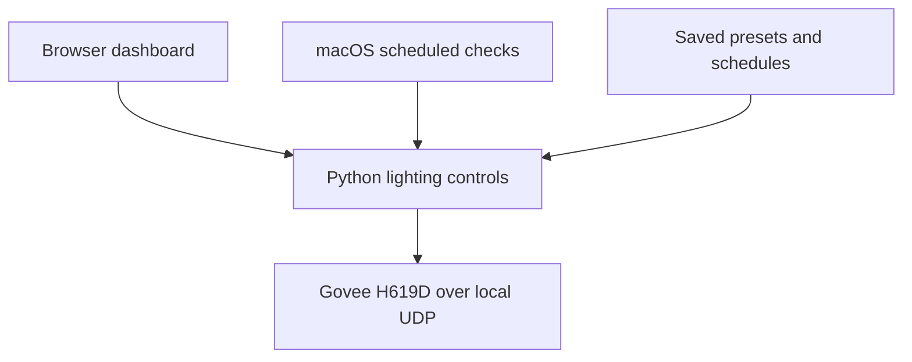

# Automated Room Project

A personal engineering project by Zachary Johnson that automates room lighting from a Mac mini. It controls a Govee H619D light strip over the local network, using saved lighting settings and a daily schedule.

## What it does today

- Turns the light on or off and changes its brightness and RGB color.
- Applies saved presets such as morning, focus, evening, and night.
- Runs enabled routines at selected times and days of the week.
- Provides a local browser dashboard for manual controls and schedule editing.
- Validates settings, logs commands, and retries detected network send failures.

The example daily routine turns lights on in the morning, changes daytime lighting, gradually dims and warms the lighting through separate evening steps, and turns it off at night. All example schedules are disabled until configured locally.

**Current scope: one light strip.** The project does not currently control a TV, play audio, switch themes automatically by season, or order room scents. Manual controls do not pause the schedule.

## How it works

The dashboard and scheduler use the same JSON settings. The dashboard handles manual controls and schedule edits; a macOS `launchd` job runs the scheduler every minute. Python sends lighting commands directly over the local network. Python's standard library is the only software dependency.



## What has been tested

| Area | Evidence |
| --- | --- |
| Physical light control | Manual power, color, and brightness results recorded October 10, 2026 |
| Unattended operation | Two observed October 10 tests: a scheduled power-on and a config-driven Morning → Focus change |
| Software behavior | Automated tests cover configuration validation, schedule matching, duplicate-run handling, network errors, and dashboard requests/saves |
| Still to verify | Physical dashboard controls, repeated daily operation, and recovery after sleep, restart, or network changes |

A successful UDP send does not confirm the light received or applied it. The Mac must be awake and connected. Missed schedule times are skipped; only one scheduler job should run at a time.

## Potential future plans

These are ideas for later development, not implemented features or commitments.

- **Pause/resume:** temporarily stop scheduled lighting changes during manual use.
- **Reliability and setup:** make Mac scheduler installation easier and test repeated operation, sleep/wake, and restart behavior.
- **Seasonal room coordination:** change room themes by time of year and investigate optional TV and audio integration.
- **Seasonal room-scent deliveries:** explore automated Amazon deliveries of room scents selected for the time of year, so seasonal scents arrive as the room theme changes. Amazon ordering, payment, and delivery integration have not been built or validated.

## Quick start

Python 3.9+ is required. The deployed scheduling approach uses macOS. Tests can run without a Govee device.

```sh
git clone https://github.com/johnsonzach0811/Automated-Room-Environment.git
cd Automated-Room-Environment
cp config.json config.local.json
python3 -B -m unittest discover -s tests -v
```

`config.json` is a portable example: its address is a documentation placeholder and every schedule is disabled. Set `device.ip` in the ignored `config.local.json` to the light's actual LAN address. Enable LAN Control in Govee Home for the supported device and place the controller on the same reachable network.

```sh
python3 -B scheduler.py validate
python3 -B dashboard.py
```

Open [http://127.0.0.1:8765](http://127.0.0.1:8765). Manual control buttons send real lighting commands. To test a preset directly:

```sh
python3 -B scheduler.py preset morning
python3 -B scheduler.py preset focus
python3 -B scheduler.py preset night
```

All entry points prefer `config.local.json` when present, otherwise `config.json`. Use `--config /absolute/path/to/config.json` to select another file. The legacy `lights.py on|off` also uses this configuration.

**Existing Mac installation:** before pulling this cleanup, copy your current working `config.json` to `config.local.json` so your device address and enabled schedules are retained. This checkout's example configuration does not enable unattended actions.

See [dashboard and setup details](docs/local-dashboard.md) and [scheduler setup](docs/configurable-automation.md). No LaunchAgent files are installed by these commands.

## Evidence and project records

- [First unattended hardware test](docs/automation-test-success-2026-10-10.md)
- [Config-driven unattended test](docs/configurable-scheduler-test-2026-10-10.md)
- [Transport and scheduler reliability](RELIABILITY.md)
- [Initial charter](docs/project-charter.md), [scope](docs/scope-statement.md), and [compatibility register](templates/compatibility-register.csv)

The original charter and dated progress notes preserve earlier planning and test history. They do not describe completed scope; the current capabilities and potential plans are listed above. No open-source license has been selected.
